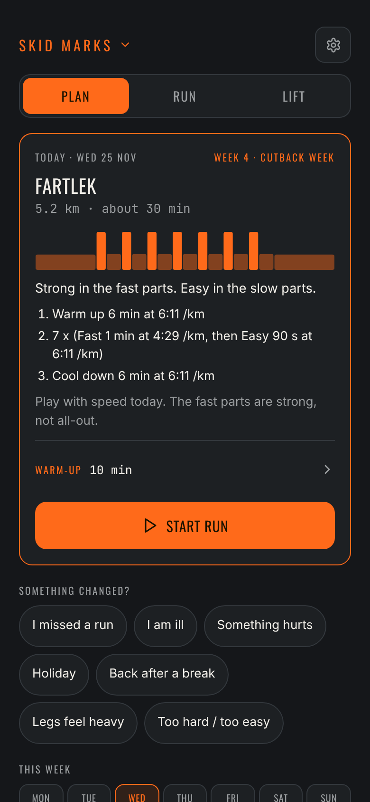
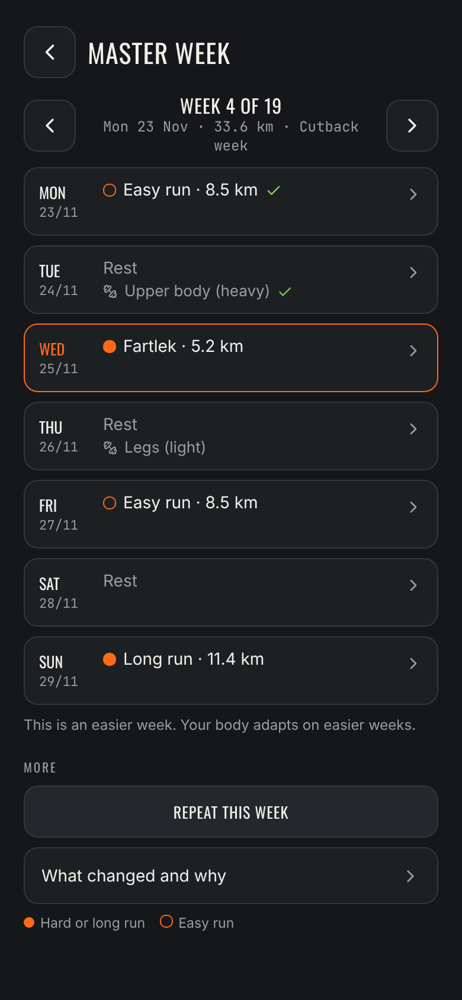
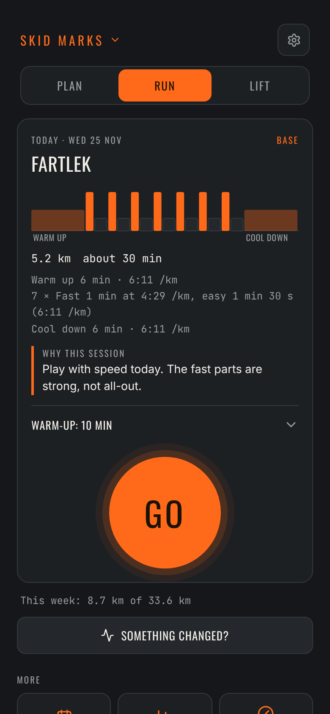
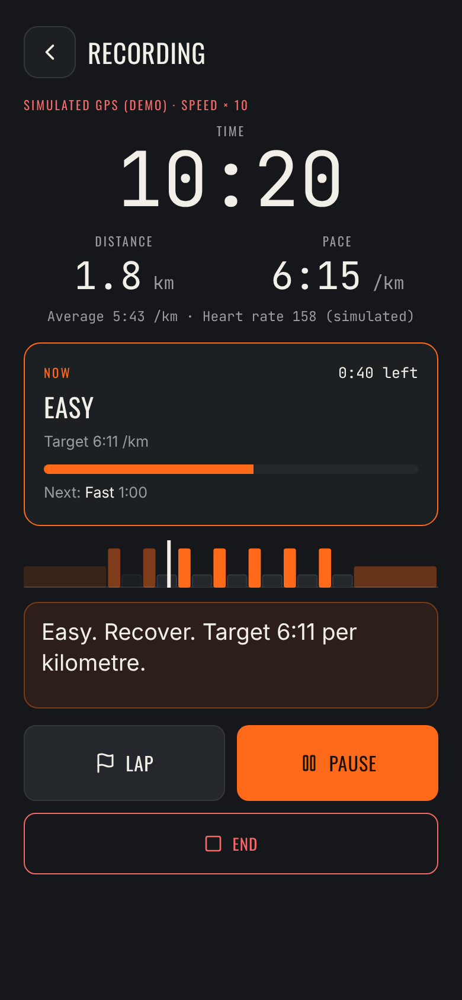
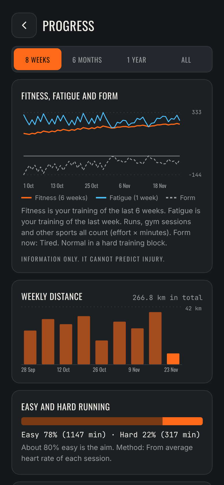
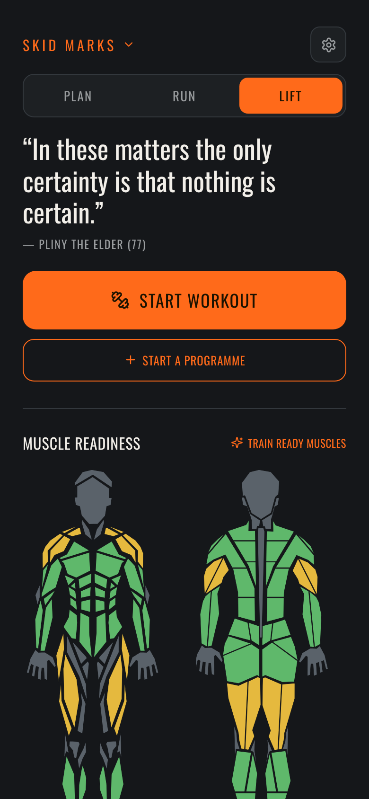
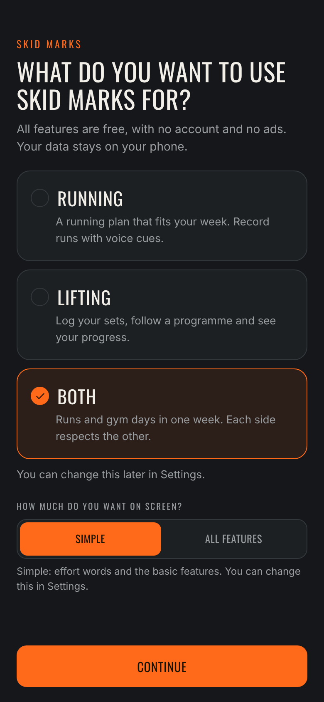

# Skid Marks

**A free running coach and gym tracker in one app. Your data stays on your phone.**

[**Download the Android app (APK)**](https://github.com/JoeBrowse/runningcoach/releases/latest/download/skid-marks.apk) · [All releases](https://github.com/JoeBrowse/runningcoach/releases) · [Privacy](docs/privacy-policy.md) · [Licence: GPL-3.0](LICENSE)

Skid Marks plans your runs around your gym days. It adapts the plan when life changes, and it tells you why each change happens. All features are free. There are no ads, no accounts and no paywall.

<p>
  
  
  
  
</p>
<p>
  
  
  
</p>

---

## Three modes, one week

Use the switch at the top of the screen: **Plan · Run · Lift**.

| Mode | What it does |
|---|---|
| **Plan** | Your master week. Run days and gym days are in one plan. Today's session, the week, a weekly review, races and goals, and the muscle readiness map. |
| **Run** | The running coach. Today's run, GPS recording with voice cues, the season chart, progress, zones and race prediction, fuel, weather, routes and the coach. |
| **Lift** | The gym tracker (based on Iron Log). Log sets, follow programmes, see 1RM progress and which muscles have recovered. Runner presets are included. |

Each session goes into one shared log. A run that you record appears in all three modes and on the muscle map. You never log a session twice.

## What makes it different

- **Plans that respect your gym days.** A heavy leg day counts as a hard day. The plan keeps heavy legs 48 hours away from quality runs and 72 hours away from the long run. Before a race, lifting changes to maintenance.
- **Safety rules that the app checks honestly.** Weekly distance grows by 10% or less. Hard days never touch. The long run is the longest run of the week. About 80% of running is easy. The checks test the real plan, and a test suite checks thousands of generated plans.
- **Changes with reasons.** Tell the app that you missed a run, were ill, have a pain, go on holiday or are back after a break. It asks its questions first. Then it changes the plan and shows each change with its reason. You can undo any change.
- **Goals with or without a race.** Run/walk to your first 5K, 5K to marathon, a 50K trail race, or goals with no date: keep fit, get faster at 5K, build to 10K. A, B and C races, a recovery block after each race, and a "What next?" step.
- **Simple or Advanced.** Simple mode uses plain effort words ("slow enough to talk") and hides scores and phases. Advanced mode shows the fitness score, zones, predictions and the fitness / fatigue / form chart.
- **Bring your history.** Import FIT, GPX and TCX files (also as GZ or ZIP files, for example the Garmin account export), many at once. Duplicates are skipped. Optional link to Intervals.icu with your own API key.

## Privacy

- All data stays on your phone. There is no Skid Marks server and no account.
- No analytics, no tracking and no ads.
- The app connects to the internet only for links that you turn on: local weather (Open-Meteo) and Intervals.icu.
- Location is used only while you record a run.
- Strava data is shown only to you. The app never sends it to an AI.
- Backups are plain JSON files that you can read.

Full policy: [docs/privacy-policy.md](docs/privacy-policy.md)

## Medical disclaimer

Skid Marks gives general training information. It is not medical advice. It cannot diagnose injuries or predict injury. The training load values are information only. Talk to a doctor before you start to train. If something hurts, see a physio or a doctor.

## Install

1. On your Android phone, open the [APK download link](https://github.com/JoeBrowse/runningcoach/releases/latest/download/skid-marks.apk).
2. Open the file. Allow your browser or file manager to install apps when Android asks.
3. Open Skid Marks.
4. Optional: install the Wear OS watch app to run with only the watch and headphones. See [docs/wear-os.md](docs/wear-os.md).

This is a test build signed with a public test key (see [signing/README.md](signing/README.md)), so Android shows a warning. All builds use the same key, so a new build installs over an old one and keeps your data. The app installs next to Iron Log and does not change Iron Log's data. To move your Iron Log data, save a backup in Iron Log and restore it in Skid Marks.

## Build from source

You need Node.js 22.

```bash
npm install
npm run dev     # local development server
npm test        # engine, import and plan tests
npm run lint    # parse check of every source file
npm run build   # production build into dist/
```

To build the Android app, you also need Java 21 and the Android SDK:

```bash
npx cap add android
node scripts/android-permissions.mjs
node scripts/android-signing.mjs
npx cap sync android
cd android && ./gradlew assembleDebug
```

GitHub Actions builds the APK on every push (`.github/workflows/android.yml`). Each push to `main` publishes the APK on a release.

## Project structure

| Path | Contents |
|---|---|
| `src/run/` | The plan engine: plans, safety rules, adaptation, prediction, load. See [src/run/ENGINE.md](src/run/ENGINE.md). |
| `src/plan/` | Plan mode: first-open setup, plan wizard, master week, life events, weekly review, races. |
| `src/runui/` | Run mode: today's run, recording, progress, zones, fuel, weather, routes, coach, shoes. |
| `src/shared/` | Shared activity store, load model, file import, Intervals.icu, weather and export. |
| `src/modes/` | The mode switch and the screen registry. See [src/modes/README.md](src/modes/README.md). |
| `src/screens/`, `src/components/`, `src/lib/`, `src/data/` | Lift mode (Iron Log). |
| `test/` | Tests (`npm test`). |
| `docs/v1-spec.md` | The V1 specification. |
| `docs/research/` | Market research of 37 apps and six user reviews. |

## Credits

- Lift mode is based on [Iron Log](https://github.com/JoeBrowse/IronLogV3).
- The muscle readiness map uses region data from [body-muscles](https://github.com/vulovix/body-muscles) by Ivan Vulović, under the Apache License 2.0. See [NOTICE](NOTICE).
- Race prediction uses the published Daniels and Gilbert equations and the Riegel formula. The app is not linked to or endorsed by their authors.

## AI assistance

Skid Marks was developed with the help of Claude (Anthropic) as a coding assistant. The developer directed the concept, the requirements, the testing and the final decisions. No user data was given to Claude.

## Licence

Skid Marks is free software under the GNU General Public License, version 3 or any later version (GPL-3.0-or-later). See [LICENSE](LICENSE).
